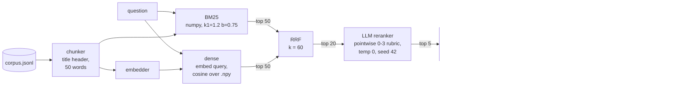

# Hybrid search RAG over internal docs, with a measured ablation

Internal documentation is full of near-duplicates: the same policy for four regions, the same spec sheet for three product tiers, the same pricing page per plan and per currency. A retriever that returns the UK travel policy for a question about the EU produces a fluent, cited and wrong answer. This project builds a small hybrid retrieval pipeline (BM25 + dense vectors, fused with Reciprocal Rank Fusion, reranked by a local LLM, answered with inline citations and checked by a deterministic citation verifier) and measures what each stage buys on a gold set designed around that failure mode.

Everything runs locally: Python standard library plus numpy and requests, and a local Ollama server. The corpus is synthetic and fictional (**Quorvia Instruments**, an invented maker of environmental sensors and a monitoring SaaS).

**Result in one paragraph.** On 135 gold questions (110 answerable, 25 unanswerable), the LLM reranker is the stage that pays: it lifts Recall@1 from 0.564 (hybrid RRF) to 0.900 and cuts wrong-entity contamination in the top 5 from 25.0% to 5.8%, and exact-fact answer accuracy goes from 78.2% to 85.5% (+7.3 points, paired bootstrap 95% CI [+1.8, +13.6]). Fusing BM25 with the dense retriever bought nothing here, because the only dense retriever available offline was LSA, which is itself lexical; RRF slightly *raised* contamination. After verification every variant declined all 25 unanswerable questions. The citation verifier caught one real wrong-entity hallucination, but with this generator it mostly flags citation mistakes on correct sentences, which costs between 0 and 4.5 points of accuracy depending on the variant. Full reference run: 40 minutes on an Apple M5 laptop with 16 GB of RAM, almost all of it LLM time.

## Architecture



Every stage is a plain function over plain data, and the evaluation computes BM25, dense and fused lists once per question and derives all four variants from the same lists, so differences between variants are not run-to-run noise.

## Design decisions, and why

**A corpus built around the failure mode** (`hybridrag/synth.py`). 96 documents in template families: 8 regional policies x 4 regions (EU, US, UK, APAC), 12 product spec sheets (4 lines x 3 tiers, each with a SKU such as `QV-PU200`), 12 pricing pages (3 plans x 4 regions), 3 SLA tiers, 10 service runbooks with error codes (`ING-5031`-style), 10 release notes with ticket ids, 5 office guides and 12 one-off documents. Siblings share their wording and differ in the entity and the numbers, and every attribute has a distinct value across siblings, so an answer copied from the wrong sibling is detectably wrong. The 135 gold questions are 35 `exact_code` (they name a SKU, error code, ticket, version or RMA prefix), 35 `lexical` (document wording, entity named), 40 `paraphrase` ("staff in Britain" for the UK policy, "the mid-range air-quality sensor" for `QV-PU200`) and 25 `unanswerable` near misses (a region, SKU, service or version that does not exist, or an attribute nobody documented). Each answerable question carries its gold document, gold fact and evidence sentence; the gold chunk is the chunk that contains the evidence. Generation is seeded and byte-identical across runs.

**Chunking with a title header** (`chunking.py`). Sections are packed into chunks of at most 50 words (249 chunks, median 42 words) and every chunk starts with its document title. Without the header, "The meal per diem is EUR 90" carries no region at all. Measured below: removing it is the largest single change in this repository.

**BM25 written in numpy** (`bm25.py`). Okapi BM25 (k1 = 1.2, b = 0.75, non-negative Lucene idf) over a precomputed chunk x vocabulary weight matrix, so a query is a column gather and a row sum. The tokenizer keeps codes whole (`qv-pu200`, `ing-5031`, `7.3`) and also emits their parts, which is what lets keyword search nail exact-code questions.

**The dense retriever is LSA, because no embedding model was available.** The plan was Ollama's `/api/embed`. On this machine (Ollama 0.40.10) it refuses every model tried, with `This server does not support embeddings. Start it with --embeddings` (probed with `qwen2.5:7b` and `qwen3.5:9b`; the probe is repeated and recorded by every `run-all`, see `results/run_meta.json`). The installed models are chat models, no dedicated embedding model is installed, and installing one was out of scope for this project. The dense stage therefore uses latent semantic analysis: TF-IDF (sublinear tf) projected on the top 128 right singular vectors of the chunk matrix, numpy only, vectors stored with `np.save` and searched by brute-force cosine. LSA captures co-occurrence, not meaning, so it behaves much like a smoothed keyword index; **a dedicated embedding model (nomic-embed-text, bge, e5) would likely do better, above all on the paraphrase questions, and was not used only because nothing could be installed.** The `Embedder` interface has an Ollama implementation and an OpenAI-compatible HTTP implementation (env-configured, tested with mocks only, never called against a paid API); `index --embedder ollama --embed-model nomic-embed-text` swaps one in.

**Reciprocal Rank Fusion** (`fusion.py`), k = 60 as in Cormack, Clarke and Buettcher, "Reciprocal Rank Fusion outperforms Condorcet and individual Rank Learning Methods" (SIGIR 2009). RRF uses ranks only, so BM25 scores and cosine similarities never have to be calibrated against each other. Each retriever contributes its top 50.

**Pointwise LLM reranker** (`rerank.py`). The top 20 fused chunks are graded one at a time by `qwen2.5:7b` against a fixed 0-3 rubric whose first criterion is the entity (same region, plan, tier, SKU, service, version or office), at temperature 0 and seed 42, with a one-token answer. Ollama returns token log-probabilities, so the grade is the expected value over the digits 0-3, which breaks most ties among passages that would all get a "3". The question comes before the passage so consecutive calls share a prompt prefix. Pointwise grading is the simplest reranker to reason about and to cache; it costs one LLM call per candidate.

**Generation with chunk-id citations** (`generate.py`). The same model answers from the top 5 chunks, ends every factual sentence with the id of its chunk (`[policy-travel-eu#1]`), is told that look-alike passages describe other entities, and must reply exactly "I don't know based on the provided documents." when no passage covers the asked entity.

**A deterministic citation verifier** (`verify.py`). Every sentence with a figure (number or identifier) or a specific claim (4+ content words) must cite at least one chunk that was in the context; every figure in it must appear in the cited chunks; a claim without figures needs half of its content words in them. Unsupported sentences are flagged and, by default, removed with a caveat; if nothing supported remains, the answer becomes "I don't know". No model is involved, so every verdict is reproducible by hand. Its blind spot is deliberate and tested: a claim copied faithfully from the wrong sibling passes, because the citation is valid. That is why the answer metrics also include an independent check against the gold document.

**Measurement** (`metrics.py`). Retrieval is scored at chunk level on the 110 answerable questions: Recall@1/3/5, MRR@10, nDCG@10, and wrong-entity contamination@k, which is 1 when a chunk of a sibling document of the same family appears in the top k above every gold chunk (or while no gold chunk is in the top k); it is defined for the 104 questions whose gold document has siblings. Answers are scored on exact-fact accuracy (every figure and content word of the gold fact appears in the answer), correct "I don't know" on the 25 unanswerable questions, the verifier's flag rate, and an independent gold-based check: the share of answers that state a figure that is in neither the gold document nor the question. Variants are compared with a paired bootstrap (10,000 resamples, seed 42) over the same questions.

## Results

All numbers come from one uncached `python3 -m hybridrag run-all --evalgen ../eval-dataset-generator` (2,402 s wall time; `results/run_meta.json`), followed by `python3 -m hybridrag eval --evalgen ../eval-dataset-generator`, which replays every LLM call from the cache (1 s) after the verifier fix described below. Artifacts are under `results/` (`results/report.md` has every table, the per-question files have every ranking, grade and answer). Reranker and generator: `qwen2.5:7b` (Q4_K_M) through Ollama 0.40.10, temperature 0, seed 42. Dense: LSA, 128 dimensions. Corpus: 96 documents, 249 chunks.

### Retrieval ablation (110 answerable questions; contamination over the 104 that have sibling documents)

| variant | Recall@1 | Recall@3 | Recall@5 | MRR@10 | nDCG@10 | Contam@1 | Contam@5 |
|---|---|---|---|---|---|---|---|
| BM25 only | 0.573 | 0.764 | 0.809 | 0.678 | 0.728 | 0.086 | 0.211 |
| Dense only (LSA) | 0.582 | 0.754 | 0.855 | 0.686 | 0.736 | 0.086 | 0.202 |
| Hybrid (RRF) | 0.564 | 0.773 | 0.827 | 0.679 | 0.733 | 0.096 | 0.250 |
| Hybrid (RRF) + LLM rerank | **0.900** | **0.918** | **0.927** | **0.911** | **0.915** | **0.019** | **0.058** |

Paired bootstrap, 95% CI (10,000 resamples over the same questions):

| comparison | Recall@1 | Recall@5 | MRR@10 | Contam@5 |
|---|---|---|---|---|
| Dense vs BM25 | +0.009 [-0.018, +0.045] | +0.045 [0.000, +0.100] | +0.008 [-0.019, +0.038] | -0.010 [-0.067, +0.048] |
| Hybrid vs BM25 | -0.009 [-0.027, 0.000] | +0.018 [-0.018, +0.054] | +0.001 [-0.014, +0.015] | +0.038 [+0.010, +0.077] |
| Hybrid + rerank vs Hybrid | +0.336 [+0.245, +0.427] | +0.100 [+0.045, +0.164] | +0.232 [+0.171, +0.296] | -0.192 [-0.269, -0.115] |

By question type (Recall@5 / MRR@10):

| variant | exact_code (35) | lexical (35) | paraphrase (40) |
|---|---|---|---|
| BM25 only | 0.971 / 0.819 | 1.000 / 0.981 | 0.500 / 0.290 |
| Dense only (LSA) | 1.000 / 0.795 | 1.000 / 0.981 | 0.600 / 0.333 |
| Hybrid (RRF) | 0.971 / 0.807 | 1.000 / 0.981 | 0.550 / 0.304 |
| Hybrid (RRF) + LLM rerank | 1.000 / 1.000 | 1.000 / 1.000 | 0.800 / 0.755 |

Read plainly:
- **The reranker does the disambiguation.** First-stage retrievers find the right family (Recall@5 above 0.8) but not the right sibling (Recall@1 below 0.6). Graded one passage at a time against an entity-first rubric, the 7B model puts the gold chunk first in 90% of questions and pushes contamination@5 down by 19 points.
- **Its ceiling is first-stage recall.** The gold chunk is within the fused top 20 for 92.7% of questions (100% exact-code and lexical, 80.0% paraphrase), and reranked Recall@5 is exactly 0.927: every miss left is a gold chunk the first stage never surfaced, all of them paraphrases. Better candidates, not a better reranker, is the next lever.
- **RRF did not help, and the reason is the dense retriever, not RRF.** Fusion pays when the two lists fail on different questions. LSA and BM25 are built from the same token counts and fail on the same paraphrases, so fusion averaged two similar rankings and let a few more sibling chunks into the top 5 (contamination +3.8 points, CI excludes zero). This is the result I would expect to change most with a real embedding model.
- **Title headers in chunks matter more than any retriever choice.** Re-indexing without the document title in each chunk (`results/ablation_no_title_header/`) drops BM25 Recall@5 from 0.809 to 0.691 and raises contamination@5 from 0.211 to 0.538; the same holds for dense (0.855 to 0.700) and hybrid (0.827 to 0.673).

### Answers and the citation verifier (generator sees the top 5 chunks of each variant)

| variant | exact-fact acc. raw | exact-fact acc. after verifier (95% CI) | correct "I don't know" (25 unanswerable) | false "I don't know" (110 answerable) | claim sentences flagged by the verifier | answers stating a figure absent from the gold doc: before -> after verifier |
|---|---|---|---|---|---|---|
| BM25 only | 77.3% | 76.4% [68.2, 84.5] | 100% | 22.7% | 1 / 89 | 0.7% -> 0.7% |
| Dense only (LSA) | 83.6% | 79.1% [70.9, 86.4] | 100% | 20.9% | 6 / 93 | 0.7% -> 0.0% |
| Hybrid (RRF) | 78.2% | 78.2% [70.0, 85.5] | 100% | 20.9% | 0 / 92 | 0.7% -> 0.7% |
| Hybrid (RRF) + LLM rerank | **87.3%** | **85.5%** [78.2, 91.8] | 100% | **13.6%** | 2 / 102 | 0.7% -> 0.7% |

Paired bootstrap on exact-fact accuracy after the verifier: rerank vs hybrid +7.3 points [+1.8, +13.6]; rerank vs BM25 +9.1 [+2.7, +16.4]; rerank vs dense +6.4 [+0.9, +12.7]; hybrid vs BM25 +1.8 [-1.8, +5.5].

| variant | gold chunk among the 5 passages | fact accuracy when it is | confidently wrong (answered without the gold fact) |
|---|---|---|---|
| BM25 only | 80.9% | 94.4% | 0.9% |
| Dense only (LSA) | 85.5% | 92.5% | 0.0% |
| Hybrid (RRF) | 82.7% | 94.5% | 0.9% |
| Hybrid (RRF) + LLM rerank | 92.7% | 92.2% | 0.9% |

What the answer side shows:
- **Retrieval failures turn into "I don't know", not into wrong answers.** With the strict instruction, `qwen2.5:7b` at temperature 0 almost never answers from the wrong sibling: at most 1 of 110 answers per variant is confidently wrong, and all 25 unanswerable near misses were declined by every variant after verification (raw: 25/25 for three variants, 24/25 for dense, the case below). Accuracy is therefore bounded by whether the gold chunk reached the context, which is why the reranker's retrieval gain shows up almost one-for-one in answers.
- **The verifier's catch.** Asked about the bike parking at the Singapore office (which the corpus deliberately does not document), the dense variant answered "45 spaces", a number taken from another office, and cited the Singapore chunk. The cited chunk does not contain 45, so the verifier removed the sentence and the answer became "I don't know". That is the hallucination it exists for.
- **The verifier's blind spot is real too.** The one wrong answer of the reranked variant ("How fast does someone on the British payroll have to respond to an alert while on standby?", answered with the Team SLA tier's 60-minute first response, citing the SLA chunk) and the BM25/hybrid answer giving the Team tier's 60 minutes for "the highest service level" pass the verifier: the citation is valid, the entity is wrong. Only the gold-document check catches them (the 0.7% column).
- **Its cost.** On this model, most flags are citation mistakes on correct sentences (the right number, cited to the neighbouring chunk of the same document, or to a chunk id that does not exist). Removing them costs 1.8 points for the reranked variant and 4.5 for dense. Every flagged sentence's figures were present somewhere in the 5 passages; none was invented from nothing.
- **Verifier fix found by the first run.** The first run's verifier required a citation in every sentence and rejected identifiers repeated from the question. Reading its flags showed it removing correct answers such as "On-call should run qvctl drain ingest-gateway ... Check recent deploys first. [runbook-ingest-gateway#1]" (one citation at the end of the paragraph) and "Warranty repairs for RMA-AP returns take 16 days" (RMA-AP comes from the question). The verifier now lets a paragraph-final citation cover the sentences before it (and still checks them against that chunk) and accepts figures that appear in the question. With the strict version, accuracy after verification was 72.7% (BM25), 79.1% (dense), 73.6% (hybrid) and 79.1% (reranked), with 5, 6, 5 and 9 flags (`results/archive/run1_strict_verifier/`). The LLM outputs are identical in both runs (cache); only the deterministic check changed.

### Measured with eval-dataset-generator

The answers were also exported in the format of my eval-dataset-generator project (`evalgen`) and scored by its own deterministic checks (action, required-fact recall, numbers unsupported by the gold document); an "I don't know" reply maps to its `decline` action. Its LLM judge was not used: its rubric is written for the support assistant of that project. Then its `gate` CLI compared each candidate with the hybrid baseline on `det_score` (`results/evalgen/`):

| version | det_score | action accuracy | gate vs hybrid (default thresholds) |
|---|---|---|---|
| hybrid (baseline) | 0.822 | 0.830 | |
| hybrid + rerank | 0.881 | 0.889 | PASS, delta +0.059, 95% CI [+0.007, +0.111] |
| BM25 only | 0.807 | 0.815 | PASS, delta -0.015, 95% CI [-0.044, +0.008] |

Two independent scorers agree on the ranking. One more data point for the gate: on the first run, with the strict verifier, the reranked variant was +0.044 better overall and still **failed** the default gate, because 5 items that passed on the baseline failed on it (limit 3); those were the citation-format removals above. The gate flagged a real behaviour change that the mean hid.

### Latency (medians per question, `results/latency.json`)

| stage | median |
|---|---|
| BM25 search | 0.19 ms |
| Dense: embed query (LSA projection) + cosine search | 0.17 + 0.06 ms |
| RRF fusion | 0.06 ms |
| LLM rerank, 20 pairs | 6.66 s (333 ms per pair) |
| Generation, top-5 context | 3.0 to 3.4 s depending on variant |
| Citation verifier | 0.13 to 0.16 ms |

Retrieval without the reranker is effectively free at this corpus size (the sub-millisecond stages are re-timed on every `eval`, so they move a little between runs; the LLM stages are the measurements stored with the cached calls); the reranker triples per-question latency and is where the quality comes from. The full run spent 862 s reranking 135 x 20 pairs and 1,539 s generating 4 x 135 answers. Other processes shared the Ollama server during the run, so expect variance between runs.

## How to run

Requirements: Python 3.11+ (developed on 3.14.8) with numpy and requests; an Ollama server with `qwen2.5:7b` for reranking and generation. The test suite needs neither Ollama nor network.

```bash
# offline tests (mocked LLM and embedders, under a second)
python3 -m unittest discover -s tests -t .

# the reference run: synth, index, eval (retrieval, rerank, answers, verifier), report
python3 -m hybridrag run-all
# same, plus scoring and gating with eval-dataset-generator (a separate checkout)
python3 -m hybridrag run-all --evalgen ../eval-dataset-generator

# step by step
python3 -m hybridrag synth --seed 42                 # data/corpus.jsonl, data/questions.jsonl
python3 -m hybridrag index                           # index/: chunks, vectors.npy, embedder state
python3 -m hybridrag retrieve "What is the battery life of the QV-PU200?" --variant bm25
python3 -m hybridrag answer "How much can staff in Britain spend on food per day on a business trip?"
python3 -m hybridrag eval                            # results/*.json, results/report.md
python3 -m hybridrag eval --no-rerank                # first-stage variants only, no LLM

# chunk title header ablation (retrieval only, no LLM)
python3 -m hybridrag --index-dir index/no_title --results-dir results/ablation_no_title_header index --no-title-header
python3 -m hybridrag --index-dir index/no_title --results-dir results/ablation_no_title_header eval --no-rerank

# with a real embedding model, if your server has one
python3 -m hybridrag index --embedder ollama --embed-model nomic-embed-text
```

Every LLM call goes through a sqlite3 cache (`.cache/llm.sqlite`) keyed on the full request, so a rerun of `eval` reproduces the reference answers in about a minute; delete the cache for an uncached run. Models, depths, thresholds and the embedder live in `config.toml`.

## Limitations

- **No neural embedding model.** The dense stage is LSA because the local Ollama refuses `/api/embed` for every installed model and nothing could be installed. The "dense" and "hybrid" rows therefore measure LSA, not a modern embedder, and the conclusion "RRF bought nothing" is specific to that. A dedicated embedding model would most likely raise paraphrase recall, which is exactly where the reranker's ceiling sits.
- **Synthetic, templated data.** Documents and questions come from templates, so the vocabulary is narrower than real internal docs and lexical questions are close to trivial (Recall@5 = 1.000 for every variant). The near-duplicate structure is deliberate and stronger than in most real corpora; the paraphrases were written by me, not collected from users.
- **Small sample.** 110 answerable and 25 unanswerable questions: 95% intervals on accuracy are about plus or minus 7 points, and differences between the three first-stage variants are inside noise except for the contamination increase from RRF. The 100% "I don't know" rate on 25 questions has a one-sided 95% lower bound of about 89%.
- **One model does everything.** `qwen2.5:7b` reranks and generates. The reranker rubric, the answer prompt and the verifier thresholds were written before the run, but by the same person who wrote the questions, and the verifier was changed once after reading the first run's flags (both versions are reported).
- **The fact matcher is simple.** A gold fact is present when all its figures and content words appear in the answer; it is order-blind and negation-blind, and it would accept a correct number stated for the wrong reason.
- **The verifier is lexical.** It checks that figures and words of a sentence exist in the cited chunk, not that the sentence means what the chunk says, and it cannot see wrong-entity answers that cite the wrong entity's chunk faithfully.
- **Latency is one laptop.** Medians from one run on an Apple M5 with 16 GB of RAM, with other processes sharing the Ollama server; treat them as observed, not as a benchmark. Determinism (temperature 0, fixed seed) is per machine; the sqlite3 cache is what makes a rerun exact.

## Next steps

- Swap LSA for a dedicated embedding model through the existing `Embedder` interface and rerun the same ablation; that is the experiment that tests whether hybrid fusion earns its place.
- Raise first-stage recall for paraphrases (query rewriting into document vocabulary, or a larger fused candidate pool) and measure the reranker ceiling again.
- Cheaper reranking: grade the top 10 instead of 20 (the gold chunk was at fused rank 11 to 20 for some paraphrases, so measure the trade), batch passages per call, or a smaller cross-encoder.
- Let the verifier repair a citation (re-point a sentence to the context chunk that contains its figures) instead of removing a correct sentence, and report repairs separately from removals.
- A human-written question set over a less templated corpus, and a second annotator for the gold facts.

## Layout

```
hybridrag/
  cli.py            python -m hybridrag <synth|index|retrieve|answer|eval|run-all>
  synth.py          seeded fictional corpus (96 docs) and gold questions (135)
  chunking.py       section-aware chunker with title header; gold chunk ids
  bm25.py           Okapi BM25 in numpy
  dense.py          Embedder interface; LSA, Ollama and OpenAI-compatible embedders; numpy vector index
  fusion.py         Reciprocal Rank Fusion
  rerank.py         pointwise LLM grader (fixed rubric, logprob-weighted grade)
  generate.py       answer prompt with chunk-id citations
  verify.py         deterministic citation verifier
  metrics.py        Recall@k, MRR, nDCG, contamination, fact match, bootstrap CIs
  providers.py      Ollama, OpenAI-compatible, scripted fake, sqlite3 cache
  pipeline.py       index, retriever, evaluation
  evalgen_bridge.py export to eval-dataset-generator, score, gate
  report.py         results/report.md
data/               generated corpus and gold questions
results/            artifacts of the reference run (report.md first)
tests/              unittest suite, offline
```

## License

MIT, see `LICENSE`.
